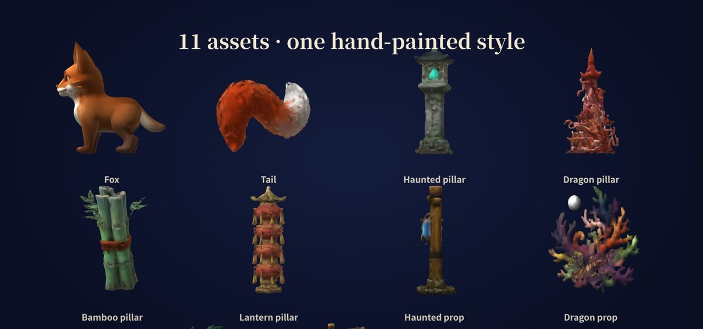
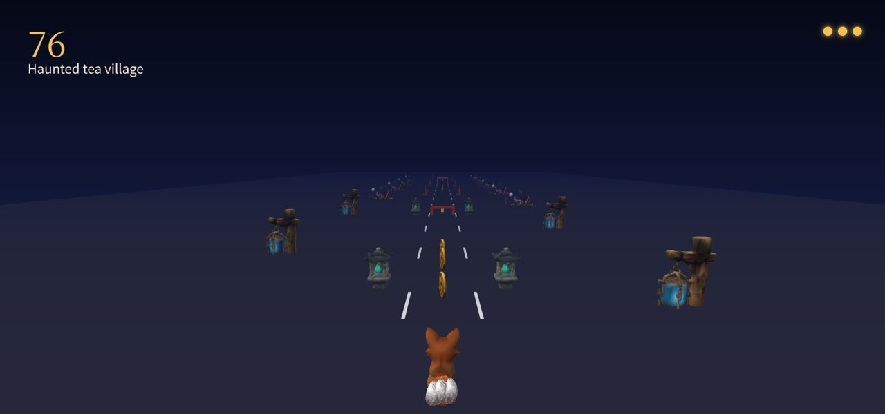
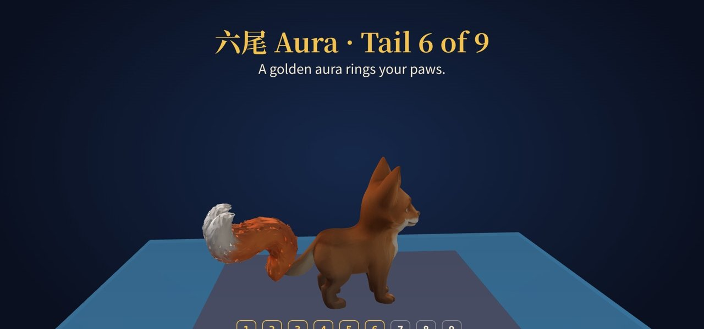
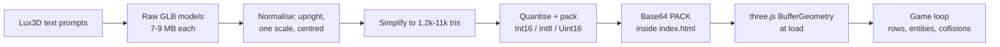
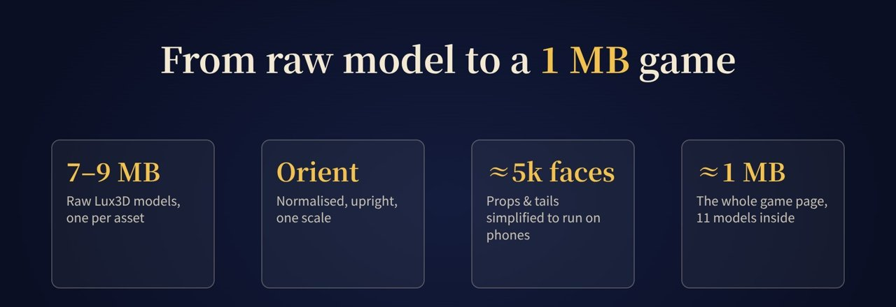

# 九尾 Nine-Tail Run

A mobile-first 3D fox-spirit endless runner that ships as **one ~1 MB HTML file**. Every 3D asset was generated with [Aholo Lux3D](https://lux3d.aholo3d.com/) from a text prompt, then optimised and embedded directly in the page.

**Play:** https://ninetailrun.bencoy.workers.dev/

Built for the Manycore Aholo Global 3D AI Hackathon · `#Manycorehackathon` `#AholoLux3D` · Gaming Application track



## Why this exists

Small teams rarely have weeks to wait for 3D art. The question behind this project: can Lux3D supply a *whole game's* worth of consistent assets, and can those assets be made light enough to load on a phone over mobile data? This repo is the answer, in a form you can open and play.

## At a glance

| | |
|---|---|
| Genre | 3-lane endless runner (swipe, jump, slide) |
| Content | 30 levels across 4 themed worlds, endless mode, shrine progression, 3D store |
| Assets | 11 Lux3D models (fox, tail, 4 pillars, 4 props, coin) |
| Payload | `index.html` = 1,059,627 bytes (about 1.0 MB), models included |
| Runtime | three.js r128 (WebGL), vanilla JavaScript, no build step |
| Persistence | `localStorage` (no backend) |
| Audio | Web Audio API, fully procedural (no audio files) |

| Gameplay | Shrine |
|---|---|
|  |  |

## Gameplay

- **Controls:** swipe left/right to change lane, up to jump, down to slide. Desktop: arrow keys or WASD, space to jump, `P`/`Esc` to pause.
- **Worlds:** Haunted tea village, Dragon palace, Bamboo mist, Lantern festival. Each has its own palette, fog, pillar and roadside prop models.
- **Levels:** 30 levels cycle through the four worlds with rising target distance. Every fifth level is a *Tribulation*: telegraphed thunder strikes and moving demon obstacles.
- **Endless mode:** a short text prompt selects a world theme (keyword match, falling back to a stable hash).
- **Tricks:** jumping low rails or sliding under high bars scores bonus points.
- **Soul Key:** a purchasable one-time revive per run.
- **Shrine:** grow from one tail to nine. Tails two to nine each have a trial and a perk.

| Tail | Perk | Trial |
|---|---|---|
| 1 | Awakening | none |
| 2 | Denser foxfire sparks | Collect 15 coins in one run |
| 3 | Coin magnet (adjacent lane) | Score 400 in one run |
| 4 | +1 life at run start | 3 tricks in one run |
| 5 | Charms last 25% longer | Score 900 in one run |
| 6 | Golden aura | Run 400 m without a hit |
| 7 | Trick bonuses doubled | 8 tricks in one run |
| 8 | Second extra life | Collect 60 coins in one run |
| 9 | Moon halo, rare Nine-Tail Seal | Score 2500 in one run |

- **Store:** a walk-around 3D shop for skins, hats, necklaces and trails. Skins are recoloured at runtime rather than shipped as extra assets.
- **Extras:** local leaderboard, player profile, shareable fox card (canvas export), music and SFX toggles, `prefers-reduced-motion` support.

## Architecture



The whole game is a single document: markup, CSS, the model `PACK`, and one script. There is no bundler, no framework and no server component.

### Asset pipeline

Raw Lux3D output was 7 to 9 MB per model. Each model is normalised, simplified and stored as typed arrays:

- positions as `Int16`, dequantised against a per-mesh centre `c` and half-extent `h`
- normals as `Int8`
- indices as `Uint16`
- vertex colours as `Uint8` for props, one embedded JPEG texture for the fox
- a small metadata block per model (dimensions, head and rump anchors, facing offset)

| Asset | Triangles | Notes |
|---|---|---|
| Fox body | 11,018 | UV-textured, recoloured per skin via a tinted texture |
| Fox tail | 3,999 | Instanced 1 to 9 times, recoloured or gold-shaded |
| 4 pillars | about 5,000 each | One per world, used as obstacles |
| 4 props | about 5,000 each | One per world, roadside scenery |
| Coin | 1,198 | Collectible |

A single tail went from **8.64 MB to 823.93 KB** in our measured pipeline run, and the full page is about 1 MB.



### Game loop and world generation

- Fixed lane model (`LW = 2.2` units), 3 lanes, frame-rate independent integration with `dt` clamped to 50 ms.
- The track is generated as **rows** spawned ahead of the player. Each row keeps at least one free lane (a bounded random walk of the free lane between rows), then places pillars, hurdles or bars in the remaining lanes. Later levels add multi-obstacle rows and moving enemies.
- Coins are placed along the free lane. Power-ups (`元宝` x3 score, `祥云` speed, `九尾令` temporary nine-tail form) spawn on the free lane.
- Scenery scrolls by recycling a ring of segments; entities are removed once past the camera.
- Collisions are lane-and-depth checks against typed obstacles (`pillar`, `low`, `high`, `orb`, `pu`), not general physics.
- Hits remove a tail (health), with invulnerability frames and camera shake. Zero tails ends the run, with an optional Soul Key revive.

### Rendering notes

- Single WebGL canvas via three.js r128, pixel ratio capped at 2.
- Vertical FOV adapts to portrait and landscape.
- Fog distance tightens as the level rises, which also hides spawn pop-in.
- Particle effects use a fixed pool of 90 meshes with no per-frame allocation.

### State

All state lives in `localStorage`:

| Key | Contents |
|---|---|
| `ntv` | Save: wallet, tail rank, owned items, level progress, stats, keys, profile |
| `ntl` | Top-5 local leaderboard |
| `nta` | Music and SFX preferences |

Every read and write is wrapped in `try/catch`, so private-mode browsers degrade to a session-only game.

## Run locally

No build step. Any static server works:

```bash
git clone https://github.com/BenCoy09/nine-tail-run.git
cd nine-tail-run
python3 -m http.server 8080
# open http://localhost:8080
```

You can also open `index.html` directly. three.js is loaded from jsDelivr with a cdnjs fallback, so the first load needs a network connection.

## Deploy

It is a static file. It runs unchanged on Cloudflare Workers static assets (the live demo), GitHub Pages, Netlify or any CDN. For GitHub Pages: Settings, Pages, deploy from the `main` branch root.

## Performance budget

| Budget | Value |
|---|---|
| Page weight (HTML, models, code) | about 1.0 MB |
| Largest model | fox body, 11k triangles |
| Typical on-screen props | 14 segments of scenery plus visible rows |
| Dependencies | one script (three.js r128) |

## Known limitations

- **Lux3D runs at build time, not runtime.** The assets were generated ahead of time and baked in. `lux3dHook(prompt)` in the source is a deliberate extension point where a server-side Lux3D call could generate assets from the endless-mode prompt. It currently returns `null`, because the API key must stay on a server and never ship to the client.
- three.js is loaded from a CDN, so the very first visit needs connectivity. Vendoring it would add roughly 600 KB.
- No automated tests. Gameplay logic is covered by manual play-testing only.
- Leaderboard is local to the device.

## Roadmap

1. Server-side Lux3D proxy so endless-mode prompts generate real, per-run props.
2. Vendor three.js for fully offline play.
3. More fox forms for the ninth tail, and more Lux3D props per world.
4. Global leaderboard behind a small edge function.

## Demo video and report

- [`project-report.pdf`](project-report.pdf): three-page hackathon report (problem, Lux3D usage, size pipeline, features).
- Demo footage was rendered from the same Lux3D models rather than recorded from the live site.

## Credits

- 3D asset generation: **Aholo Lux3D** by Manycore Tech
- Rendering: [three.js](https://threejs.org/)
- Hosting: Cloudflare Workers

## License

[MIT](LICENSE) © 2026 Benjamin (Benny)
